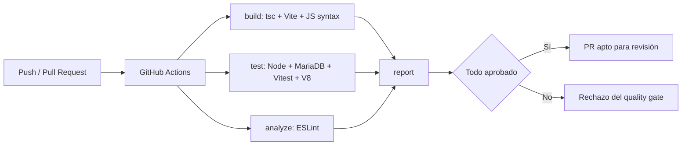

# Manual técnico — Pipeline ACS SQA
## Arquitectura

Los cuatro jobs son controles automatizados. **No hay despliegue a producción**.

## Entornos y comandos
Requiere Node 22, npm y, para pruebas reales de persistencia, MariaDB/MySQL aislada.
```bash
npm ci --prefix backend
npm ci --prefix frontend
npm run check --prefix backend
npm run typecheck --prefix frontend
npm run build:client --prefix frontend
npm test --prefix frontend
npm test --prefix backend
```
Para pruebas de integración real, preparar base `stglobal_test` y exportar `RUN_DB_TESTS=1`, `DB_HOST`, `DB_PORT`, `DB_NAME`, `DB_USER`, `DB_PASS`, `JWT_SECRET` y `COOKIE_NAME`. No usar una base productiva.

## Implementación
- `backend/app.js`: factoría de Express sin escuchar puerto.
- `backend/server.js`: arranque real del servicio.
- `backend/utils/consultation.js`: validación independiente.
- `backend/models/consultationModel.js`: propiedad del registro se verifica en UPDATE y SELECT.
- `backend/tests/`: unitarias de validación, controladores y flujos HTTP con DB aislada.
- `frontend/client/lib/agenda.ts`: generación y validación de franjas.
- `frontend/client/lib/agenda.spec.ts`: casos sobre agenda.
- `.github/workflows/quality.yml`: jobs automatizados.
- `eslint.config.mjs`: reglas de análisis estático.
- `sonar-project.properties`: configuración inicial para SonarCloud.

## Decisiones técnicas
1. Node.js `node:test` como alternativa justificada a Jest: no añade dependencias y admite cobertura V8 con umbral.
2. Vitest para pruebas React; reutiliza dependencia existente.
3. MariaDB efímera en GitHub Actions para verificar CRUD real sin datos ajenos.
4. Frontend y API se validan por separado.
5. `main` no recibe cambios sin revisión; la protección administrativa aún debe activarse.
6. El módulo Passport de Google no se inicializa en `app.js` porque la aplicación usa `/auth/google` con verificación directa; la estrategia existente no se usa en rutas actuales.

## Mantenimiento y seguimiento
- Agregar prueba por cada fallo corregido; registrar ID en `docs/Matriz-Pruebas.md`.
- El runner debe tener el mismo Node mayor (22) y MariaDB de pruebas.
- Revisar `actions/runs` y descargar artefactos `acs-test-evidence`, `acs-static-evidence` y `acs-summary`.
- Para instalar protección: Settings → Branches/Rulesets → `main` → exigir pull request y checks `build`, `test`, `analyze`, `report`, sin bypass.
- SonarCloud requiere organización/proyecto y `SONAR_TOKEN`; sin este prerrequisito no se declara análisis Sonar ejecutado.
